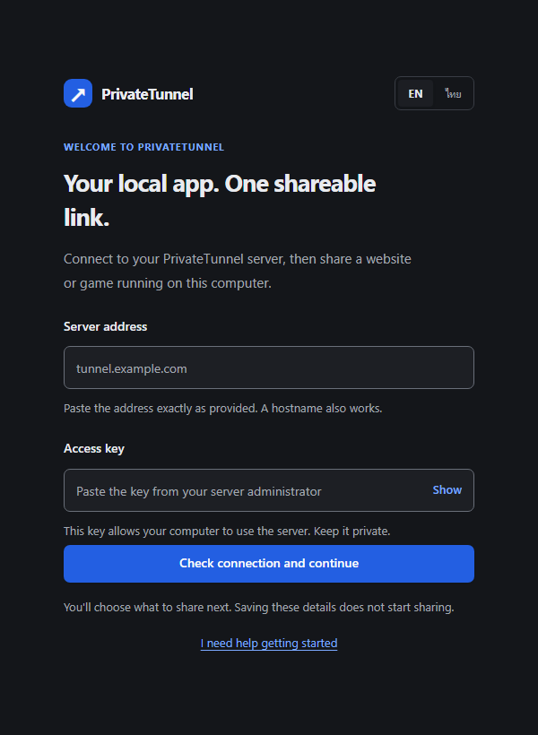

# PrivateTunnel

Share a local website, TCP service, or ESP device through a server you control.

[Downloads](https://github.com/Jindanet/private-tunnel/releases) · [Thai documentation](README.th.md) · [Device setup](docs/en/devices.md) · [Server setup](docs/en/server.md)

I built PrivateTunnel because I wanted a straightforward way to reach my own services from outside my network while keeping the public server under my control. A local website should be easy to share, a game server should have an address I can copy, and a sensor should not need a computer running beside it just to stay online.

The desktop app handles everyday sharing. The CLI handles terminals, servers and Termux. PrivateTunnel Device runs native C++ on ESP32 and ESP8266 with a smaller HTTP protocol suited to their memory limits. All clients connect outward to the server; their network does not need an inbound port forward.

## What is available

Version **1.4.3** fixes Stop sharing for Windows boot tunnels and recovery when uninstalling a locked runtime. Stop now waits for the worker to exit and keeps the job paused until Start or the next boot. Update both endpoints and reinstall boot jobs after updating their client; these jobs use a separate runtime copy. The five-minute TCP idle cutoff was removed in 1.4.2. Other RDP disconnects still require connection logs. Device support remains **experimental**; physical board, TLS peak heap and continuous Wi-Fi tests still require real hardware.

| Client | Platforms | Services |
| --- | --- | --- |
| Desktop | Windows download; Windows/Linux/macOS source builds | Local HTTP and TCP; Minecraft Java preset |
| CLI | Node.js 22.12+; native Windows/Linux x64 and macOS x64/arm64 downloads | HTTP and TCP, including reachable LAN targets |
| Standalone `ptunnel.js` | Node.js 22.12+, including Termux `nodejs-lts` | Same CLI without npm or native dependencies |
| PrivateTunnel Device | Arduino ESP32 and ESP8266 cores | HTTP callbacks in firmware, one request at a time |
| AVR Arduino, such as Uno R3 | Through an ESP32, Termux or computer gateway | No direct AVR TLS client |

Desktop and CLI can start before login through OS service facilities. Android uses Termux:Boot and remains subject to Android restrictions. Firmware starts when powered on. [Startup guide](docs/en/startup.md).

## Desktop setup

1. Get the server hostname and an individual **Desktop / CLI** key from your administrator.
2. Download and extract the Windows desktop ZIP from [Releases](https://github.com/Jindanet/private-tunnel/releases).
3. Open PrivateTunnel, enter the server and key, and select **Check and continue**.
4. Start your local service, add its port or local HTTP URL, then start sharing and copy the public address.

HTTP addresses open in a browser. TCP addresses are `host:port` and belong in the relevant game, SSH or other TCP client. A saved profile remembers configuration; the sharing status tells you whether it is connected now.



The desktop and administrator pages support English and Thai and stay dark in either OS theme. Documentation reuses existing captures; this update did not run the app locally to capture new images.

## Termux: install and start in one line

First installation into `$HOME/private-tunnel`:

```bash
pkg update -y && pkg install nodejs-lts git -y && git clone --depth 1 https://github.com/Jindanet/private-tunnel.git "$HOME/private-tunnel" && cd "$HOME/private-tunnel" && node ptunnel.js
```

Setup asks for the server, key, tunnel type and local port, then connects. Run `node ptunnel.js` again to reuse the last tunnel. No npm, Python, compiler, Electron or SQLite is needed. Keep the checkout in Termux's private home directory.

Existing installation, after preserving any local edits:

```bash
cd "$HOME/private-tunnel" && git pull --ff-only && node ptunnel.js
```

## CLI quick start

On a computer with Node.js **22.12+** and Git:

```bash
git clone https://github.com/Jindanet/private-tunnel.git && cd private-tunnel && node ptunnel.js
```

After saving your server and key:

```bash
node ptunnel.js http 3000
node ptunnel.js tcp 25565
node ptunnel.js http 192.168.1.50:80
node ptunnel.js tcp 22 --startup
node ptunnel.js startup status
```

`--startup` installs a boot service with the saved settings. The OS may request administrator privileges. Configure the target service, such as SSH, to start independently too. [CLI commands](docs/en/cli.md) · [Startup and removal](docs/en/startup.md).

## ESP32 and ESP8266

1. Update the server and create an **ESP32 / ESP8266 device** key in administrator Settings. Save both the connection key and the separate visitor password, shown once.
2. Install the release's `PrivateTunnelDevice-v1.4.3-arduino.zip` with **Sketch → Include Library → Add .ZIP Library** and install the matching ESP core. You can also copy `device/PrivateTunnelDevice` into the sketchbook's `libraries` folder.
3. Open **File → Examples → PrivateTunnelDevice → ProvisionedHttp**, choose your board and upload.
4. Open Serial Monitor at **115200**. Join `PrivateTunnel-Setup` Wi-Fi using its printed password. Open `http://192.168.4.1/` and save Wi-Fi, server hostname, full WebSocket path, device key and trusted root CA.
5. The board restarts and reconnects automatically. Open its public `/status` URL using username `device` and the visitor password, or send that password as a Bearer token.

The client calls registered C++ functions directly. It does not relay an existing board web server or provide native TCP. The first version uses 512-byte frames, a 512-byte flow-control window and a maximum 1 KiB request body. Flash responses stream in chunks. TLS needs additional RAM and may not fit alongside a large ESP8266 application. [Device installation, API and limits](docs/en/devices.md).

## Your own server

You need a publicly reachable server, DNS names you control and HTTPS termination such as Nginx. Use separate names, for example `admin.example.com` for administration/client connections and `*.apps.example.com` for published websites.

```bash
git clone https://github.com/Jindanet/private-tunnel.git
cd private-tunnel
npm ci
cp .env.example .env
# Set your real domains and storage paths before starting.
npm run server
```

Internal listeners default to loopback: WebSocket **8080**, administration **8081**, HTTP proxy **8082**. First boot generates a private administrator bootstrap password when none is supplied. Finish DNS, TLS and reverse-proxy setup before connecting remote clients. For TCP, preopen **30000–40000** in the relevant host/cloud firewalls and NAT; declaring a range does not verify connectivity. [Server deployment](docs/en/server.md).

## Documentation

| Guide | Contents |
| --- | --- |
| [Getting started](docs/en/getting-started.md) | Downloads, desktop, Termux and updates |
| [CLI](docs/en/cli.md) | Profiles, HTTP/TCP targets and command reference |
| [Boot startup](docs/en/startup.md) | Windows, systemd, LaunchDaemon, Termux:Boot and removal |
| [Devices](docs/en/devices.md) | Provisioning, callback API, protocol, RAM and hardware validation |
| [Server](docs/en/server.md) | DNS, TLS, reverse proxy, services and backups |
| [Configuration](docs/en/configuration.md) | Environment variables, stored settings and upgrades |
| [Architecture and security](docs/en/architecture.md) | Design decisions, trust boundaries, privacy and limitations |
| [Troubleshooting](docs/en/troubleshooting.md) | Connection, key, port, startup and device failures |
| [Development](docs/en/development.md) | Source layout, testing, firmware builds and releases |

## Security and current limitations

Desktop HTTP and TCP services are public unless the service authenticates visitors; TCP also supports a server IP allowlist. **Device HTTP requires a separate visitor password by default.** In Settings, turn off Require visitor password for a device key when its firmware handles sign-in; the change applies immediately without changing the board key. A connection key authorizes tunnel creation and should not be given to website visitors.

The server handles forwarded traffic. WSS protects the client-to-server link; it is not end-to-end encryption through that server. This single-server project has no built-in MFA, administrator roles, automatic updater, device TCP/UDP or public multi-tenant abuse controls. Release binaries are unsigned. See [trust boundaries](docs/en/architecture.md) and [vulnerability reporting](SECURITY.md).

## Configuration reference

See the [configuration reference](docs/en/configuration.md). Back up the database, environment and client-key registry together.

## Upgrade from 1.0 to 1.1

Follow the [upgrade notes](docs/en/configuration.md#upgrades), including explicit database selection, loopback listeners and reverse-proxy routes.

## Upgrade to 1.2: client keys and profiles

Issue individual keys for new profiles and preserve reservation ownership. Device keys add registry fields; back up before using them or considering a downgrade. [Upgrade notes](docs/en/configuration.md#upgrades).

[MIT license](LICENSE) · [Changelog](CHANGELOG.md)
