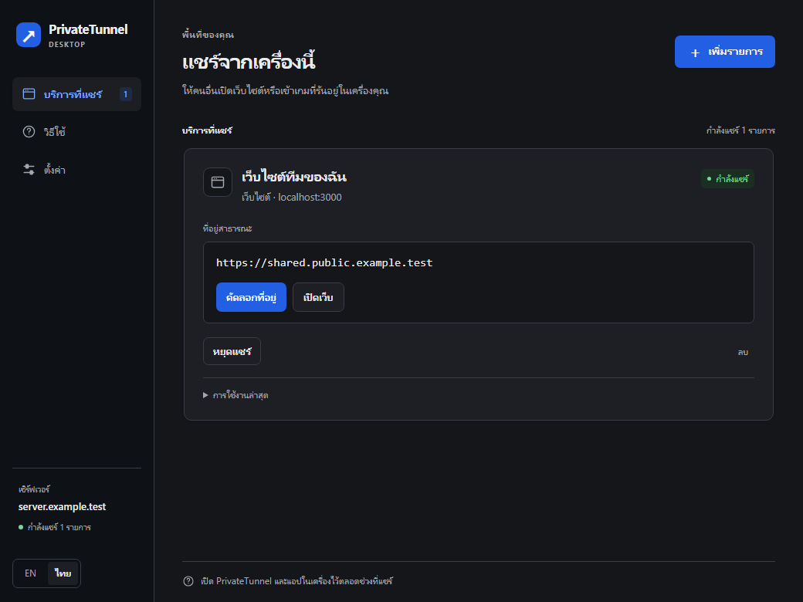
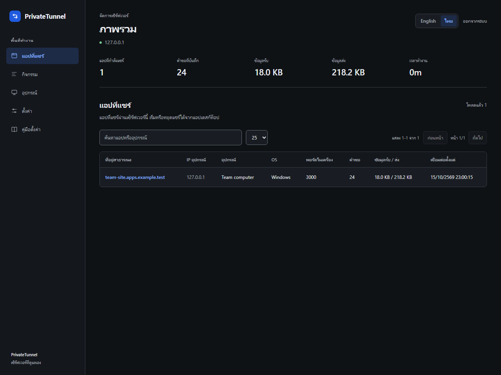

# PrivateTunnel

แชร์เว็บไซต์หรือบริการจากเครื่องของคุณผ่านเซิร์ฟเวอร์ที่ดูแลเอง รองรับแอปเดสก์ท็อปและคำสั่ง CLI ภาษาไทย/อังกฤษ

Share a local website or TCP service through a server you control. Version **1.2.0** adds client-specific keys, owner-bound host reservations and streaming reliability. **Public multi-user hosting still requires independent review, capacity testing and operational controls**; see the limitations below.

## เริ่มใช้งานด้วยแอป / Desktop quick start

ขอข้อมูล 2 อย่างจากผู้ดูแล: **ที่อยู่เซิร์ฟเวอร์** เช่น `admin.example.com` และ **กุญแจเข้าใช้งาน** อย่าส่งกุญแจให้ผู้ชมเว็บไซต์

1. เปิด PrivateTunnel เลือกภาษา กรอกที่อยู่เซิร์ฟเวอร์กับกุญแจ แล้วกด **ตรวจสอบและไปต่อ**
2. เปิดเว็บไซต์ของคุณในเครื่องก่อน จากนั้นกด **เพิ่มรายการ** เลือก **เว็บไซต์** แล้ววาง `http://localhost:3000` หรือกรอกพอร์ต `3000` และกด **เริ่มแชร์** สำหรับ Minecraft Java ใช้ตัวเลือกเริ่มต้นที่หน้าแรกได้
3. เมื่อแสดงสถานะ **กำลังแชร์** กด **คัดลอกที่อยู่** เพื่อส่งให้ผู้ชม หรือ **เปิดเว็บ** เพื่อทดสอบ กด **หยุดแชร์** เมื่อใช้งานเสร็จ

Ask the administrator for the server address and access key. Check and save them once, then add a website by pasting its local HTTP address or entering its port. Copy or open the assigned public address when connected. The creation page keeps names and custom-domain options collapsed. Minecraft Java has a quick-start preset. Saving a profile does not guarantee that a later connection will succeed.



The desktop uses a sidebar on wider windows and compact top navigation on smaller windows. The administrator interface follows the same visual system; server setup guidance appears only when domain settings are incomplete.

Dark mode is the default for the desktop and administrator pages, including login and settings, regardless of the operating system theme.



พอร์ตคือเลขท้ายที่อยู่เว็บไซต์ในเครื่อง เช่น `localhost:3000` ใช้พอร์ต `3000` ส่วน TCP ใช้กับบริการ เช่น เกมหรือ SSH และที่อยู่ที่ได้เป็น `host:port` ซึ่งต้องเปิดผ่านแอปของบริการนั้น

สำหรับ TCP เซิร์ฟเวอร์จะเลือกพอร์ตสาธารณะให้อัตโนมัติ ใช้ที่อยู่ล่าสุดที่แอปแสดง และให้ผู้ดูแลเปิดพอร์ตนั้นในไฟร์วอลล์หรือเราเตอร์ก่อนเชื่อมต่อจากภายนอก

To run the desktop from source, install Node.js **22.12+** and run in this folder:

```powershell
npm ci
npm run app
```

The Windows build is currently an **unsigned development build**. Code signing, notarization and automatic updates are not configured. Only use artifacts from a source you trust; a checksum does not prove the publisher's identity.

## ใช้ผ่านคำสั่ง / CLI in two steps

Use the included CLI directly to avoid confusion with unrelated programs also named `ptunnel`:

```bash
# 1. Save the server profile once (replace the example address and key).
node client/bin/ptunnel.js init --server wss://admin.example.com/_private-tunnel/ws --token YOUR_ACCESS_KEY

# 2. Start sharing your running local website.
node client/bin/ptunnel.js http 3000
```

Other commands:

```bash
node client/bin/ptunnel.js tcp 25565
node client/bin/ptunnel.js status
node client/bin/ptunnel.js reset
node client/bin/ptunnel.js http 3000 --domain apps.example.com
node client/bin/ptunnel.js http 3000 --domain demo.example.net --root
```

`--server` and `--token` belong to setup; do not combine them with a tunnel command. `npm link` optionally installs the short `ptunnel` command; check for a conflicting installation first. Profiles are stored in `~/.ptunnel` (Windows: `%USERPROFILE%\.ptunnel`). This file contains the access key. POSIX permissions are set to `0600`; restrict the user's Windows profile ACL too. Passing the key on the CLI can also leave it in shell history.

## เมื่อติดปัญหา / Common problems

| What you see | What to do |
| --- | --- |
| No server profile | Ask the administrator for the server address and access key, then save them. |
| Authentication failed | Copy the current access key again; a rotated key invalidates the old one. |
| Connection failed / reconnecting | Check internet access and the server address. Ask the administrator to check DNS, TLS and the server. |
| Local service unavailable / 502 | Open `http://localhost:PORT` locally first and check the port in the sharing profile. |
| Share address is `host:port` | This is TCP. Copy it into the game/SSH/service client; it is not a website URL. |
| HMR, Socket.IO or app WebSockets do not connect | Application WebSocket upgrade passthrough is not supported. Use a normal HTTP workflow. |

## สำหรับผู้ดูแล / Set up a server

You need Node.js 22.12+, a server, DNS access, Nginx and TLS certificates. The default storage is SQLite; MySQL is optional. The application does not configure your DNS, certificates or Nginx automatically.

1. Install dependencies with `npm ci`. Copy `.env.example` to `.env` (`Copy-Item .env.example .env` in PowerShell, `cp .env.example .env` on Linux).
2. Set `PRIMARY_DOMAIN` to the exact admin hostname and `TUNNEL_DOMAIN` to the public website domain. For example, `admin.example.com` and `apps.example.com`. Keep the internal bind address `127.0.0.1` and `AUTO_FIREWALL=false`.
3. Start with `npm run server` as a regular service user. An empty admin password generates `<DATA_DIR>/admin-bootstrap.txt`. Protect this file and the data directory. The database's generated legacy shared key is unused by default; create individual keys in Settings instead.
4. Configure Nginx, DNS and certificates using [the deployment guide](deploy/README.md) and [the Nginx template](deploy/nginx.example.conf). Check with `nginx -t` before reloading.
5. Open `https://admin.example.com/_private-tunnel/admin`, sign in using the bootstrap password, and change it. Rotation removes the bootstrap file and invalidates current sessions. In **Settings → Client access keys**, create a named key per person or device and send its one-time secret with the server address to that owner.

The three internal ports must remain private:

| Port | Purpose | External route |
| --- | --- | --- |
| 8080 | Client WebSocket | Exact admin host + `/_private-tunnel/ws` |
| 8081 | Dashboard and admin API | Exact admin host + `/_private-tunnel/admin` |
| 8082 | Published HTTP requests | Configured publish hosts |

For each TCP tunnel, the server's operating system selects an available public port. Use the assigned `host:port` displayed in the client or dashboard; it can change after reconnecting or restarting the server. The administrator must allow that specific port in host/cloud firewalls and set up NAT forwarding where applicable. With the default `AUTO_FIREWALL=false`, PrivateTunnel does not create firewall rules. There is no configured public TCP port range. Run the process without root or Administrator privileges.

`GET http://127.0.0.1:8081/healthz` is a local liveness probe. It does not confirm that DNS, TLS, a database mirror, public tunnels or clients are healthy. SIGINT/SIGTERM closes listeners and active tunnels; existing streams are interrupted, not drained to completion.

### Domains and Nginx

Keep the exact admin host in its own TLS server block. Every published host, including a wildcard under the primary domain, must reject the exact control root and its child paths. The generated template uses both `location = /_private-tunnel` and `location ^~ /_private-tunnel/` for that boundary.

The admin host routes only admin and client WebSocket paths. Public application traffic goes to the proxy port. `/_private-tunnel` is reserved, so a published application cannot use it. `/api` remains available to the application. The legacy `/ws` endpoint still exists on the admin host; current clients use the control namespace.

Publish domains can permit immediate subdomains, the exact root host, or both. Root publishing on the primary admin host is disabled. DNS wildcard records and wildcard certificates are separate requirements. Wildcard TLS certificates require DNS-01 validation; a wildcard certificate does not cover the bare domain. See [Let's Encrypt challenge documentation](https://letsencrypt.org/docs/challenge-types/#dns-01-challenge).

Nginx examples assume it runs on the same host as PrivateTunnel. The server trusts forwarded IP/protocol headers only from loopback connections. Do not expose internal listeners or move the proxy behind a bridge without designing and testing an explicit trusted-proxy configuration.

### Configuration reference

`.env` seeds domains, access key and admin password into the database on first boot. The control root initially uses `/_private-tunnel`; it is not seeded from `.env`. **After that, stored settings take precedence.** Change those settings in the dashboard. Listener ports, bind address and database options are startup settings and require a restart.

Any supplied access key must contain 32–4096 visible ASCII characters without whitespace. Keys beginning with `your-`, `your_`, `replace-`, `replace_`, `change-`, `change_`, `example-` or `example_` are rejected, ignoring case. Use a cryptographically random key; passing the format and length checks does not establish entropy. An invalid nonempty `TUNNEL_TOKEN` prevents startup, even if a stored key exists. An invalid legacy stored key leaves administrator sign-in available, but tunnel authentication is denied until the key is rotated; Settings cannot be saved while retaining that key.

| Variable | Default | Purpose |
| --- | --- | --- |
| `INTERNAL_HOST` | `127.0.0.1` | Internal listener address |
| `WS_PORT`, `DASHBOARD_PORT`, `PROXY_PORT` | `8080`, `8081`, `8082` | Internal ports |
| `PRIMARY_DOMAIN`, `TUNNEL_DOMAIN` | empty | First-boot admin and publish domains |
| `TUNNEL_TOKEN` | generated on first boot | Legacy shared access key, unused unless shared-key compatibility is enabled |
| `DASHBOARD_PASSWORD` | generated on first boot | Admin bootstrap password |
| `DATA_DIR` | `./data` | Private runtime files |
| `AUTO_FIREWALL` | `false` | Optional legacy privileged firewall automation |
| `TCP_BIND_HOST` | OS interfaces | Optional local interface IP for public TCP listeners |
| `TCP_VISITOR_ALLOWLIST` | empty (public) | Optional comma-separated visitor IP addresses/CIDRs |
| `ALLOW_SHARED_TUNNEL_TOKEN` | `false` | Restore legacy shared-key authentication for trusted migration only |
| `REQUIRE_DATA_TRANSPORT_V4` | `true` | Reject old data-plane clients without receive-credit support |
| `HTTP_IDLE_TIMEOUT_MS` | `30000` | Per-request inactivity, 50–3600000 ms; active streams may run longer |
| `ALLOW_LEGACY_QUERY_TOKEN` | `false` | Temporary compatibility for old query-token clients |
| `ALLOW_UNAUTHENTICATED_TUNNELS` | `false` | Explicit opt-in to unauthenticated test tunnels |
| `REQUEST_LOGGING` | `true` | Record new request metadata; set `false` to disable |
| `DB_PROVIDER` | `sqlite` | Primary backend: `sqlite` or `mysql` |
| `SQLITE_PATH` | `<DATA_DIR>/tunnel.db` | SQLite database; explicit path takes precedence over `DATA_DIR`; legacy alias `DB_PATH` |
| `DB_SYNC_TARGETS` | empty | Optional comma-separated mirror backends |
| `DB_SYNC_STRICT` | `true` | Fail on mirror errors in non-production migration mode |
| `DB_BOOTSTRAP_SYNC` | `false` | Optional automatic seed into an empty backend |

For MySQL, set `MYSQL_HOST`, `MYSQL_PORT` (3306), `MYSQL_USER`, `MYSQL_PASSWORD` and `MYSQL_DATABASE`. Use a dedicated database user. Schema setup may create the database if the account permits it; pre-create the database if you do not grant that permission.

Changing `DATA_DIR` does not relocate an explicitly configured `SQLITE_PATH` (or legacy `DB_PATH`). The example environment file sets both paths; update both when moving SQLite state.

### Storage, backup and migration

Use one backend with scheduled, tested backups. `NODE_ENV=production` rejects mirror targets other than the primary backend. Non-production migration compatibility remains available; strict mirror errors are enabled by default. With an explicit `DB_SYNC_STRICT=false`, mirror errors are logged but writes may diverge. Strict mode cannot make a cross-database write atomic. Bootstrap copying is disabled unless explicitly enabled. A mirror is neither automatic failover nor a backup.

For a planned migration, stop the service, back up every source and destination, configure the intended backend and empty target, then enable bootstrap sync only for the migration. Verify the resulting settings, clients and logs before disabling sync and resuming use. Never point it at an unrelated database. Schema changes run automatically at startup; versioned migration rollback is not implemented. Restore a matching pre-upgrade database and application version to roll back.

## Upgrade from 1.0 to 1.1

Back up `.env`, the database(s), data directory and client profiles before upgrading. Test the upgrade separately before using your live database.

- **Existing MySQL users must explicitly set `DB_PROVIDER=mysql` before upgrading if they relied on the old default.** The new default is SQLite; an omitted value can otherwise start a separate empty database.
- Mirror targets are now empty by default and `DB_BOOTSTRAP_SYNC` defaults to false. Existing explicit environment values still apply. Review them before startup.
- Internal listeners now bind to `127.0.0.1`. Put Nginx on the same host. Do not expose these ports to restore the old behavior.
- Remove obsolete `TCP_PORT_MIN` and `TCP_PORT_MAX` environment entries. Public TCP ports are now selected by the operating system; check the displayed address and update firewall/NAT rules after each allocation.
- Update clients: the access key now travels in `Authorization: Bearer ...`, not the WebSocket URL. Old query-token clients need the temporary `ALLOW_LEGACY_QUERY_TOKEN=true` switch. Disable it after updating clients and rotate any key that may be present in logs.
- Missing access keys no longer mean an open server. A first boot with no stored key generates one; unauthenticated mode requires explicit opt-in.
- Review access keys before restarting: nonempty environment keys must meet the 32–4096 visible-ASCII format and placeholder-prefix rules above or startup fails. Existing invalid stored keys keep administrator sign-in available but deny tunnel authentication; rotate the key in Settings before saving, then update all clients. Use a random key rather than extending a memorable password to the minimum length. Existing stored settings still take precedence over valid `.env` values.
- Re-generate Nginx snippets and review every publish host. The exact admin host and wildcard publish hosts must use separate TLS blocks.
- Legacy password hashes migrate to salted scrypt after a successful login. Change the admin password afterward and protect database backups.

The application control protocol remains version 1 in `shared/protocol.js`. Explicitly incompatible control versions are rejected. Modern servers require data transport v4 by default; legacy data transport requires explicit migration opt-in.

### Upgrade to 1.2: client keys and profiles

1. Back up the database, `.env`, data directory (including `client-keys.json`) and client profiles. Update server and clients together.
2. Sign in to administrator **Settings → Client access keys**. Issue a named key for each person or device. Copy its secret when created; it cannot be recovered from the server. Rotation keeps the same owner and host reservations, disconnecting only that key's existing connections. Revocation disables the key and its sessions. Each key can open at most 16 simultaneous control connections; streams retain their existing bounds.
3. Replace the client's old shared key with its individual key. `ALLOW_SHARED_TUNNEL_TOKEN=false` is the default, so the old shared secret no longer authenticates. Temporary `true` restores the old trusted-team mode; it does not turn shared users into isolated identities. Legacy callers cannot assert an individual key's reserved identity namespace.
4. Existing shared-key host reservations are not silently transferred to the first new key that asserts an old profile ID. Use a different hostname, or have the administrator release the old reservation in a controlled maintenance process. Reissue/rotation preserves new reservations; keep `client-keys.json` with the database when restoring. The registry is single-process state, not an HA key service; do not edit it while the service is running.
5. Desktop profiles now use `~/.ptunnel-desktop.json`, with tokens encrypted using Electron `safeStorage` after OS credential storage is ready. The old `~/.ptunnel` CLI profile is imported read-only on first desktop startup and is never overwritten. An unavailable/locked keyring prevents persistent credentials and shows a setup error. Linux requires Secret Service or KWallet; plaintext `basic_text` storage is rejected. The CLI still uses its separate plaintext `0600` profile: remove/rotate any unused legacy key there and protect the account and backups.
6. Remote client connections require `wss://`. Unencrypted `ws://` is allowed only for exact localhost/loopback development addresses. Public TCP remains a raw service; configure service TLS/authentication as required. `TCP_BIND_HOST` selects a local interface IP and `TCP_VISITOR_ALLOWLIST` accepts comma-separated visitor IPs/CIDRs. No fixed TCP allocation range is restored.
7. HTTP timeout is now **inactivity**, configured by `HTTP_IDLE_TIMEOUT_MS` (default 30000). Upload bytes, response headers and response data refresh only that request's timer. Active large transfers/SSE may exceed 30 seconds. If an idle/error/disconnect occurs after headers, the response is destroyed so the caller detects an incomplete transfer; gateway error text is never appended to the body. The public proxy has no separate total upload receipt deadline; header parsing remains bounded. Review reverse-proxy/application timeouts separately.
8. Sign in and change any legacy SHA-256 administrator password before **2027-01-01 UTC**. Successful legacy sign-in upgrades to scrypt until that cutoff; legacy hashes are rejected from that date. Preserve a reviewed offline recovery/backup procedure for installations that miss this migration.

### HTTP/TCP data transport v4

Current desktop and CLI clients use `shared/tunnel-v4.js`. During tunnel setup they advertise `dataTransportVersions: [4, 1]`; an updated server selects `dataTransportVersion: 4` in its assignment. Servers default to `REQUIRE_DATA_TRANSPORT_V4=true` and reject clients without v4 before allocating a tunnel. `false` explicitly restores older-client compatibility for migration, including v1 buffering limitations. A client connecting to an older server that omits selection still falls back to v1. The base `shared/protocol.js` is preserved unchanged. The supplied v2/v3/game-pipe prototypes informed the design; the running application imports the new v4 implementation.

V4 retains the existing JSON controls and UUID stream identities. Data is split into frames of at most 32 KiB, scheduled fairly across streams, and sent under both a 128 KiB per-stream credit window and a 1 MiB connection window. Credit accounts for payload plus a fixed 256-unit charge per frame to bound tiny-frame metadata too. Receivers return credit after the destination's write callback completes. A slow local service pauses the corresponding producer; send queues also have 512 KiB / 1,024 chunks per stream and 4 MiB / 8,192 chunks per connection hard limits. These bounds reduce application buffering; they are not a process-wide memory budget or a throughput guarantee.

End-of-stream controls wait behind queued data. Modern TCP connections preserve independent EOF directions, allowing a service to reply after the visitor has finished sending. Aborts discard queued bytes and release resources. TCP sockets enable no-delay and keepalive. V4 does not add UDP, compression, application WebSocket passthrough or horizontal scaling. Authentication is checked at the WebSocket upgrade boundary, with individual key ownership applied to route checks and tunnel creation. Server heartbeats terminate a peer after two missed reply rounds; the client also terminates locally after 90 seconds without server messages, allowing recovery when the connection is blackholed. Reconnects use bounded exponential jitter and stop after authentication rejection.

The internal `TunnelClient` option `dataTransportVersions: [1]` forces legacy transport for compatibility testing. Desktop users do not need to choose a protocol. Rebuild both server/client code and the desktop package to use the new implementation; already-built binaries do not change when source files are edited.

## Security and current limitations

This release improves several boundaries; it does not make an untrusted public hosting service safe. Before broader use, the project still needs independent review, load testing and operational design.

- **Keys and ownership:** individual keys authenticate separate owners, with rotation/revocation and owner-bound saved hostname profiles. Keys currently grant publishing on the server's configured domains; per-domain policies, key expiration and billing quotas are not implemented. The optional shared-key compatibility mode is intended only for trusted users.
- **Public services:** anyone who can reach a published HTTP/TCP endpoint can access it unless the local application implements authentication or a TCP visitor allowlist restricts it. TCP allowlists use the actual socket peer, not forwarded headers; a proxy/NAT may therefore be the visible peer. Public TCP has no built-in TLS or visitor login. TLS on the control connection does not encrypt the visitor-to-public-TCP leg.
- **Transport and privacy:** Nginx terminates HTTPS and the server can read traffic. There is no end-to-end encryption through the server. Individual server keys are stored as SHA-256 digests of randomly generated high-entropy tokens; desktop keys use OS-backed storage. CLI profiles and legacy shared-key database settings still contain plaintext credentials; protect those files and backups. OS-backed storage does not protect against malware already acting as the signed-in user.
- **Request metadata:** stored paths/referrers omit URL queries/fragments and HTTP URL credentials. Full request headers and bodies are not persisted by this logger. Metadata can still contain private path segments, visitor IPs and user agents. Retention is seven days with periodic cleanup; `REQUEST_LOGGING=false` disables new metadata logs. Older rows and backups are not retroactively redacted, and your Nginx/application logs have separate privacy settings.
- **Compatibility:** UDP and application WebSocket upgrade passthrough are not implemented. HTTP streams expire on inactivity, not elapsed duration. Explicit v1 compatibility lacks receive-credit flow control and retains its original buffer/overflow behavior; keep v4 required on exposed servers.
- **Capacity and availability:** bounded buffers, connection limits and timeouts reduce obvious resource abuse. Per-user bandwidth quotas, public abuse handling, HA, horizontal scaling and Prometheus metrics are not implemented. Tunnel/session state is local to one process. Reconnect cannot resume an interrupted TCP stream.
- **Administration:** one administrator password, no accounts/RBAC, MFA or durable security audit trail. Liveness is not an end-to-end availability guarantee.
- **Authentication limits:** a pre-authentication per-IP limit of 60 WebSocket upgrade attempts per minute covers both tunnel routes and administrator live updates, independently of HTTP administrator-login throttling. Shared proxy addresses can therefore share an allowance.
- **Release trust:** desktop signing, notarization and in-app automatic updates are not configured. GitHub Actions builds and publishes versioned releases automatically; Windows desktop archives remain unsigned.

### Vulnerability reports

Use the repository's private **Security → Report a vulnerability** channel if the owner has enabled private vulnerability reporting. Otherwise contact the repository owner privately using a contact method they have published. No dedicated security inbox or response-time SLA is currently published. Do not put active access keys, customer traffic, database files or a working exploit against a live server in a public issue. Include the affected version, deployment layout, expected behavior, observed impact and a minimal reproduction in a controlled environment. Known limitations above are not a waiver of security findings.

## Development, tests and builds

```bash
npm ci
npm test
npm run app
npm run server
```

The Node test runner covers binary protocol parsing/backpressure, domain/control routing, Nginx host separation, authentication and additional runtime regressions. It also launches the installed Electron binary for renderer integration against a local test fixture. `npm test` automatically installs Electron first through its pretest step, avoiding concurrent binary downloads on a fresh checkout. Do not skip the Electron download for tests. CI runs the suite on Ubuntu 24.04 and Windows with Node 22 and 24. Linux without a display needs the Electron runtime libraries and `xvfb-run --auto-servernum npm test`; see the CI workflow's dependency list. A passing suite is not a penetration test or load test.

Desktop builds:

```bash
npm run build:app:win
npm run build:app:linux
npm run build:app:mac
```

Build on the corresponding operating system. Windows output is `dist-app/win-unpacked/PrivateTunnel.exe`; distribute the complete folder, not the executable alone. The Windows target deliberately prepares an unsigned development directory. Close running copies before rebuilding if Windows reports a locked file. Do not work around a locked native module by deleting arbitrary files from an active install.

CLI build commands are `npm run build:win`, `npm run build:linux` and `npm run build:macos`. Desktop native module packaging and signing need validation on each target platform before a public release.

### Automatic releases

Push `main` with a new stable `package.json`/lockfile version and **Build and publish release** runs automatically. It tests on Linux and Windows, audits production dependencies, builds the Windows desktop ZIP and CLI binaries for Windows/Linux/macOS (Intel and Apple Silicon), and smoke-tests each CLI on its native runner. Only after all jobs succeed does it create `vX.Y.Z`, upload all six assets plus SHA-256 checksums, and publish the GitHub Release as Latest. No manual GitHub upload or tag is needed.

For the next patch release, run `npm version patch --no-git-tag-version`, commit the updated package files with your changes, and push `main`. Minor/major updates can use `npm version minor`/`major` with the same flag. A push without a version change skips rebuilding an already-published release. Release notes use `deploy/RELEASE-X.Y.Z.md` if present, otherwise GitHub generates them automatically.

The workflow can also be run manually on `main`, or by pushing a matching `vX.Y.Z` tag. Failed uploads leave an unpublished draft; re-run the original failed workflow to finish it. Published versions are never overwritten, tags never move, and versions older than Latest cannot become a new release. Bump the version for further code changes after a release. Build/test jobs have read-only repository access; only the final publishing job can write release metadata and assets, using the built-in `GITHUB_TOKEN` rather than an extra personal token.

See [release notes and preparation](deploy/RELEASE-1.2.0.md), [change history](CHANGELOG.md), [deployment](deploy/README.md), [security reporting](SECURITY.md), and [MIT license](LICENSE). Check the workflow result and Releases page to confirm publication; package metadata alone is not proof of a successful build.
