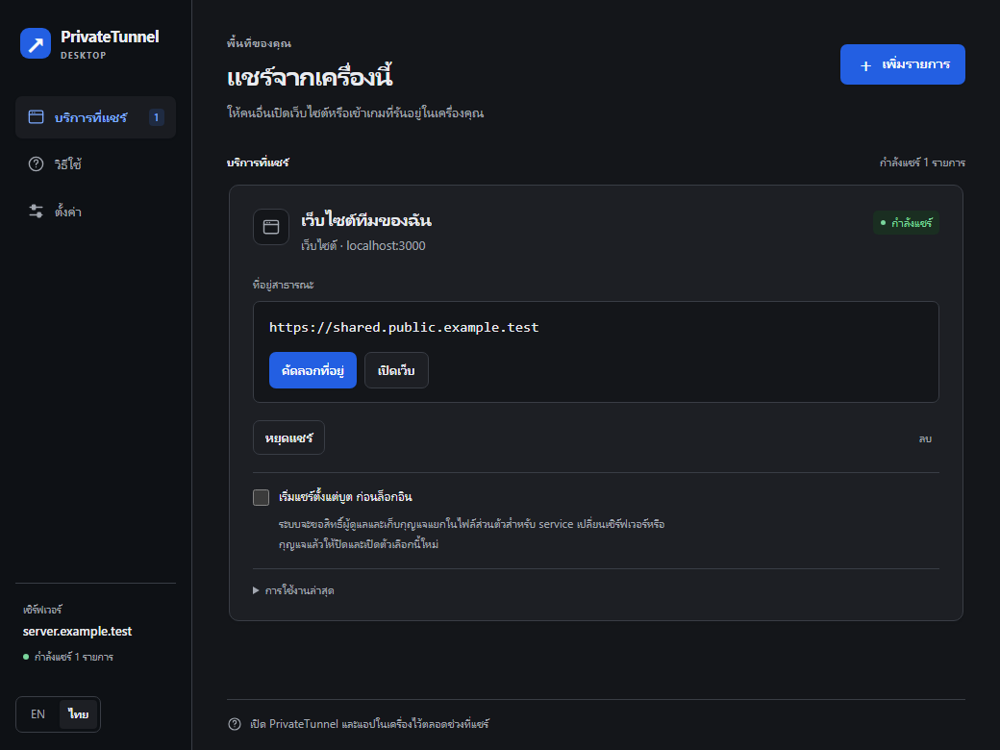

# PrivateTunnel

แชร์เว็บไซต์ บริการในเครื่อง หรืออุปกรณ์ ESP ผ่านเซิร์ฟเวอร์ที่คุณดูแลเอง

[ดาวน์โหลด](https://github.com/Jindanet/private-tunnel/releases) · [เอกสารภาษาอังกฤษ](README.md) · [ติดตั้งบนบอร์ด](docs/th/devices.md) · [ติดตั้งเซิร์ฟเวอร์](docs/th/server.md)

ผมสร้าง PrivateTunnel เพราะอยากเข้าถึงบริการของตัวเองจากนอกเครือข่ายได้ง่าย และยังเลือกดูแลเซิร์ฟเวอร์สาธารณะเองได้ เว็บในเครื่องควรแชร์ได้โดยไม่ต้องตั้งค่าหลายจุด เซิร์ฟเวอร์เกมควรมีที่อยู่ให้คัดลอก และบอร์ดเซนเซอร์ไม่ควรต้องเปิดคอมอีกเครื่องค้างไว้เพียงเพื่อให้เชื่อมต่อได้

แอปเดสก์ท็อปเหมาะกับการใช้งานทั่วไป ส่วน CLI ใช้กับเทอร์มินัล เครื่องเซิร์ฟเวอร์ และ Termux สำหรับ ESP32 กับ ESP8266 ผมเพิ่ม PrivateTunnel Device ที่เขียนด้วย C++ และใช้โปรโตคอล HTTP ขนาดเล็กลงให้เหมาะกับหน่วยความจำของบอร์ด ทั้งหมดเป็นฝ่ายเชื่อมออกไปหาเซิร์ฟเวอร์ จึงไม่ต้องเปิดพอร์ตขาเข้าที่เราเตอร์ฝั่งไคลเอนต์

## ตอนนี้ทำอะไรได้บ้าง

รุ่น **1.4.0** เพิ่มไคลเอนต์สำหรับบอร์ดเป็นครั้งแรก ส่วนนี้ยังเป็น **รุ่นทดลอง** มีการทดสอบเซิร์ฟเวอร์อัตโนมัติและคอมไพล์เฟิร์มแวร์ แต่ยังต้องทดสอบบนบอร์ดจริง โดยเฉพาะ RAM สูงสุดขณะทำ TLS และการเชื่อมต่อ Wi-Fi ต่อเนื่อง

| ไคลเอนต์ | ใช้บนอะไร | แชร์อะไรได้ |
| --- | --- | --- |
| แอปเดสก์ท็อป | มีไฟล์ Windows; สร้างจากซอร์สบน Windows, Linux และ macOS ได้ | เว็บในเครื่องและ TCP มีตัวเลือกสำหรับ Minecraft Java |
| CLI | Node.js 22.12 ขึ้นไป; มีไฟล์ Windows/Linux x64 และ macOS x64/arm64 | HTTP และ TCP รวมบริการในเครือข่ายที่เครื่องเข้าถึงได้ |
| ไฟล์ `ptunnel.js` | Node.js 22.12 ขึ้นไป รวมถึง `nodejs-lts` ของ Termux | CLI แบบไฟล์เดียว ไม่ต้องใช้ npm หรือส่วนเสริมเนทีฟ |
| PrivateTunnel Device | Arduino core ของ ESP32 หรือ ESP8266 | ฟังก์ชัน HTTP ในเฟิร์มแวร์ ครั้งละหนึ่งคำขอ |
| Arduino แบบ AVR เช่น Uno R3 | ใช้ ESP32, Termux หรือคอมเป็นตัวกลาง | ไม่มีไคลเอนต์ TLS สำหรับ AVR โดยตรง |

แอปกับ CLI ตั้งให้ทำงานตั้งแต่บูตก่อนล็อกอินได้ผ่านบริการของระบบปฏิบัติการ Android ใช้ Termux:Boot และยังมีข้อจำกัดของระบบ ส่วนเฟิร์มแวร์บอร์ดเริ่มทำงานเมื่อจ่ายไฟ [อ่านเรื่องเริ่มอัตโนมัติ](docs/th/startup.md)

## เริ่มด้วยแอปเดสก์ท็อป

1. ขอชื่อเซิร์ฟเวอร์และกุญแจประเภท **เดสก์ท็อป / CLI** จากผู้ดูแล
2. ดาวน์โหลดไฟล์แอป Windows แบบ ZIP จาก[หน้าดาวน์โหลด](https://github.com/Jindanet/private-tunnel/releases) แตกไฟล์ แล้วเปิด PrivateTunnel
3. กรอกเซิร์ฟเวอร์กับกุญแจ กด **ตรวจสอบและไปต่อ**
4. เปิดบริการในเครื่องก่อน เพิ่มพอร์ตหรือที่อยู่เว็บในเครื่อง จากนั้นเริ่มแชร์และคัดลอกที่อยู่สาธารณะ

ที่อยู่ HTTP เปิดด้วยเบราว์เซอร์ ส่วน TCP ได้ `host:port` ให้นำไปใส่ในเกม โปรแกรม SSH หรือโปรแกรมของบริการนั้น การบันทึกรายการเป็นเพียงการจำค่า ต้องดูสถานะกำลังแชร์เพื่อยืนยันว่าเชื่อมต่ออยู่จริง



แอปและหน้าแอดมินใช้ได้ทั้งไทยและอังกฤษ และคงสีเข้มแม้ระบบปฏิบัติการใช้ธีมสว่าง ภาพในเอกสารนำภาพที่เคยบันทึกไว้มาใช้ การอัปเดตครั้งนี้ไม่ได้เปิดแอปในเครื่องเพื่อถ่ายภาพใหม่

## ติดตั้งบน Termux ด้วยคำสั่งเดียว

ติดตั้งครั้งแรกไว้ที่ `$HOME/private-tunnel`:

```bash
pkg update -y && pkg install nodejs-lts git -y && git clone --depth 1 https://github.com/Jindanet/private-tunnel.git "$HOME/private-tunnel" && cd "$HOME/private-tunnel" && node ptunnel.js
```

โปรแกรมถามเซิร์ฟเวอร์ กุญแจ ประเภทการแชร์ และพอร์ต แล้วเชื่อมต่อให้ทันที ครั้งต่อไปใช้ `node ptunnel.js` เพื่อเปิดรายการล่าสุด ไม่ต้องติดตั้ง npm, Python, compiler, Electron หรือ SQLite ให้เก็บโฟลเดอร์ไว้ในพื้นที่ส่วนตัวของ Termux

หากติดตั้งไว้แล้ว ให้รักษาการแก้ไขของตัวเองก่อน แล้วอัปเดตด้วย:

```bash
cd "$HOME/private-tunnel" && git pull --ff-only && node ptunnel.js
```

## ใช้ผ่านคำสั่ง

บนคอมที่มี Node.js **22.12 ขึ้นไป** และ Git ติดตั้งครั้งแรกได้ด้วย:

```bash
git clone https://github.com/Jindanet/private-tunnel.git && cd private-tunnel && node ptunnel.js
```

หลังบันทึกเซิร์ฟเวอร์และกุญแจแล้ว เลือกบริการได้ เช่น:

```bash
node ptunnel.js http 3000
node ptunnel.js tcp 25565
node ptunnel.js http 192.168.1.50:80
node ptunnel.js tcp 22 --startup
node ptunnel.js startup status
```

`--startup` ติดตั้งบริการให้เริ่มตั้งแต่บูตด้วยค่าที่บันทึกไว้ ระบบปฏิบัติการอาจขอสิทธิ์ผู้ดูแล ต้องตั้งให้บริการปลายทาง เช่น SSH เริ่มเองด้วย [คู่มือคำสั่ง](docs/th/cli.md) · [เริ่มอัตโนมัติและถอนบริการ](docs/th/startup.md)

## ใช้กับ ESP32 หรือ ESP8266

1. อัปเดตเซิร์ฟเวอร์ แล้วสร้างกุญแจประเภท **อุปกรณ์ ESP32 / ESP8266** ในหน้าตั้งค่าของแอดมิน เก็บทั้งกุญแจเชื่อมต่อและรหัสผ่านเข้าชมเว็บที่แสดงครั้งเดียว
2. ติดตั้ง `PrivateTunnelDevice-v1.4.0-arduino.zip` จากหน้าดาวน์โหลดผ่าน **Sketch → Include Library → Add .ZIP Library** และติดตั้ง core ให้ตรงชิป หรือคัดลอก `device/PrivateTunnelDevice` ไปไว้ใน `libraries` ของสมุดสเก็ตช์ก็ได้
3. เปิด **File → Examples → PrivateTunnelDevice → ProvisionedHttp** เลือกบอร์ดแล้วอัปโหลด
4. เปิด Serial Monitor ที่ **115200** เชื่อม Wi-Fi ชั่วคราว `PrivateTunnel-Setup` ด้วยรหัสที่พิมพ์ออกมา เปิด `http://192.168.4.1/` แล้วกรอก Wi-Fi, ชื่อเซิร์ฟเวอร์, path ของ WebSocket แบบเต็ม, กุญแจเชื่อมต่อ และใบรับรองรากที่เชื่อถือได้
5. บอร์ดรีสตาร์ตแล้วเชื่อมต่อเอง เปิดที่อยู่สาธารณะที่ลงท้าย `/status` ด้วยชื่อผู้ใช้ `device` และรหัสผ่านเข้าชมเว็บ หรือใช้รหัสผ่านนี้เป็น Bearer token

เฟิร์มแวร์เรียกฟังก์ชัน C++ ที่ลงทะเบียนไว้โดยตรง ยังไม่ส่งต่อเว็บเซิร์ฟเวอร์เดิมในบอร์ดและยังไม่มี TCP สำหรับบอร์ด รุ่นแรกใช้ frame 512 ไบต์ หน้าต่างควบคุมการส่ง 512 ไบต์ และเนื้อหาคำขอสูงสุด 1 KiB ส่วนข้อมูลตอบกลับจาก flash ส่งเป็นชิ้นได้ TLS ยังใช้ RAM เพิ่ม โปรแกรม ESP8266 ที่มีงานอื่นมากจึงอาจเหลือหน่วยความจำไม่พอ [คู่มือติดตั้งและข้อจำกัด](docs/th/devices.md)

## ติดตั้งเซิร์ฟเวอร์ของตัวเอง

ต้องมีเครื่องที่อินเทอร์เน็ตเข้าถึงได้ โดเมนที่ดูแล DNS ได้ และ HTTPS เช่น Nginx แยกชื่อสำหรับแอดมินและการเชื่อมต่อไคลเอนต์ออกจากชื่อเว็บที่แชร์ เช่น `admin.example.com` กับ `*.apps.example.com`

```bash
git clone https://github.com/Jindanet/private-tunnel.git
cd private-tunnel
npm ci
cp .env.example .env
# แก้โดเมนและที่เก็บข้อมูลให้ตรงกับเครื่องก่อนเริ่ม
npm run server
```

พอร์ตภายในฟังที่ loopback: WebSocket **8080**, แอดมิน **8081**, ตัวส่งต่อ HTTP **8082** หากไม่กำหนดรหัสแอดมินในการเริ่มครั้งแรก ระบบสร้างไฟล์รหัสผ่านส่วนตัวให้ ต้องตั้ง DNS, HTTPS และ reverse proxy ให้เสร็จก่อนเชื่อมต่อจากภายนอก สำหรับ TCP ต้องเปิดช่วง **30000–40000** ในไฟร์วอลล์ของเครื่อง คลาวด์ และ NAT ที่เกี่ยวข้อง การกำหนดช่วงพอร์ตไม่ได้ตรวจว่าไฟร์วอลล์เปิดแล้ว [ติดตั้งเซิร์ฟเวอร์](docs/th/server.md)

## คู่มือทั้งหมด

| คู่มือ | เนื้อหา |
| --- | --- |
| [เริ่มใช้งาน](docs/th/getting-started.md) | ไฟล์ดาวน์โหลด แอป Termux และการอัปเดต |
| [คำสั่ง](docs/th/cli.md) | รายการที่บันทึก เป้าหมาย HTTP/TCP และคำสั่งจัดการ |
| [เริ่มตั้งแต่บูต](docs/th/startup.md) | Windows, systemd, LaunchDaemon, Termux:Boot และการถอนบริการ |
| [อุปกรณ์](docs/th/devices.md) | ตั้งค่า เขียนฟังก์ชัน โปรโตคอล หน่วยความจำ และการทดสอบบอร์ดจริง |
| [เซิร์ฟเวอร์](docs/th/server.md) | DNS, TLS, reverse proxy, บริการระบบ และการสำรองข้อมูล |
| [การตั้งค่า](docs/th/configuration.md) | ตัวแปรสภาพแวดล้อม ฐานข้อมูล และการย้ายรุ่น |
| [โครงสร้างและความปลอดภัย](docs/th/architecture.md) | เหตุผลของโปรโตคอล ขอบเขตความเชื่อถือ และข้อมูลส่วนตัว |
| [แก้ปัญหา](docs/th/troubleshooting.md) | การเชื่อมต่อ กุญแจ พอร์ต บริการอัตโนมัติ และบอร์ด |
| [พัฒนาโปรแกรม](docs/th/development.md) | โครงสร้างซอร์ส ทดสอบ คอมไพล์ และออกรุ่นใหม่ |

## ข้อจำกัดที่ควรรู้

เว็บและ TCP จากเดสก์ท็อปหรือ CLI เปิดให้บุคคลทั่วไปเข้าถึง เว้นแต่บริการนั้นยืนยันตัวตนของผู้เข้าชมเอง TCP ตั้งรายการ IP ที่อนุญาตฝั่งเซิร์ฟเวอร์ได้ ส่วน **เว็บของอุปกรณ์ต้องใช้รหัสผ่านเข้าชมแยกเป็นค่าเริ่มต้น** กุญแจเชื่อมต่อใช้อนุญาตให้สร้าง tunnel ไม่ใช่รหัสสำหรับแจกให้ผู้ชมเว็บ

เซิร์ฟเวอร์สาธารณะอ่านข้อมูลที่ส่งผ่านได้ WSS เข้ารหัสระหว่างไคลเอนต์กับเซิร์ฟเวอร์ ไม่ใช่การเข้ารหัสที่เซิร์ฟเวอร์อ่านไม่ได้ ระบบนี้ใช้เซิร์ฟเวอร์เดียว ยังไม่มี MFA, สิทธิ์แอดมินหลายระดับ, ระบบอัปเดตอัตโนมัติ, TCP/UDP สำหรับบอร์ด หรือเครื่องมือควบคุมการใช้งานผิดประเภทสำหรับเปิดบริการสาธารณะหลายผู้ใช้ ไฟล์สำเร็จรูปยังไม่ได้ลงลายเซ็น [ขอบเขตความปลอดภัย](docs/th/architecture.md)

[ใบอนุญาต MIT](LICENSE) · [ประวัติการเปลี่ยนแปลง](CHANGELOG.md) · [แจ้งช่องโหว่](SECURITY.md)
