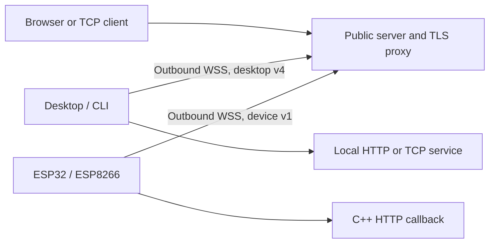

# Architecture, security and limits

[Overview](../../README.md) · [Thai guide](../th/architecture.md)

I keep the server self-hosted so the person deploying it controls DNS, credentials and retained metadata. That also makes the server an explicit trust boundary: its operator can read forwarded traffic and is responsible for access policy, updates and capacity.

## Two transports for different machines

Desktop v4 supports multiple HTTP/TCP streams with per-stream receive credit of **128 KiB**, connection credit of **1 MiB** and data frames up to **32 KiB**. Metadata also consumes credit to bound tiny-frame overhead. Outgoing queues have byte and chunk limits; backpressure pauses sources instead of treating unlimited RAM as a queue. A control heartbeat runs every 30 seconds; missed replies and a client watchdog detect dead links. Active HTTP progress refreshes inactivity timeouts, so a healthy long response is not cut off solely because 30 seconds elapsed.

Device v1 instead supports **one HTTP request**, 512-byte frames/windows and a 1 KiB complete request body. A server-created adapter reuses the manager's authentication-bound ownership, host assignment, request logging and cleanup. This trusted adapter is not a remote JSON flag and does not allow desktop clients to bypass `REQUIRE_DATA_TRANSPORT_V4`. C++ buffers are fixed; Wi-Fi, TLS and configuration costs remain additional. [Wire specification](devices.md#wire-protocol).

I chose callbacks rather than connecting back to a second HTTP server on the board to avoid another socket and duplicated buffering. The tradeoff is a deliberately small API: no arbitrary header forwarding, native device TCP, UDP or application WebSocket upgrades. Disconnecting does not resume an interrupted TCP session or request.

## Authentication boundaries

- **Administrator:** one password and a session, with protected mutations and password hashing. No MFA or per-administrator roles.
- **Client connection:** a separately issued random key, sent in the Authorization header. The server stores hashes. Profile identifiers are namespaced under the authenticated key, so a different key cannot claim another owner's reservation merely by copying a client ID.
- **Desktop/CLI visitors:** public access by default. The application provides login/authorization. Optional TCP IP/CIDR restrictions apply to actual peer addresses.
- **Device visitors:** a different random password, checked by the server before delivery to firmware. Basic authentication uses username `device`; scripts can use a Bearer token. Firmware still validates the operation and its input.

Individual-key sessions are limited to sixteen per key and the control listener has an overall client limit and upgrade attempt limiting. These are basic bounds, not a complete public-hosting quota or abuse system. Rotate or revoke a key in Settings to disconnect its sessions. Device rotation replaces both connection and visitor secrets.

## Encryption and credential storage

Remote clients require WSS. The server's TLS proxy terminates HTTPS/WSS, so traffic is readable within that trust boundary. Raw TCP is not automatically wrapped in application TLS; use SSH, TLS or another secure protocol when required. Keep internal listeners private and preserve exact administrator/publishing host separation.

Desktop settings live in `~/.ptunnel-desktop.json`, with the key protected by Electron safeStorage/OS keyring. Linux needs a real Secret Service/KWallet backend; insecure `basic_text` fallback is rejected. If the keyring cannot decrypt an existing key, reconnect it or enter the key again; there is no silent plaintext fallback. CLI `~/.ptunnel`, boot-job snapshots and the device example's EEPROM are plaintext within their respective local protections. An attacker with those files or physical flash access may obtain credentials.

## Logs and privacy

Request logs contain metadata such as method, path, status, IP and user agent, not full headers or bodies. Queries/fragments are redacted and old request rows are periodically removed after seven days. Paths can still contain private identifiers. `REQUEST_LOGGING=false` stops new metadata only; existing databases, backups, screenshots and reverse-proxy logs need separate handling. Nginx logging is independent of the application setting.

## Operational limits

This is a single-server system, not a horizontally coordinated cluster. It has no built-in HA, automatic updates, signed desktop/native releases, durable administrator audit trail, Prometheus exporter, per-domain key scopes or key expiry. Database mirrors cannot provide atomic transactions across backends and are disabled as non-primary targets in production.

Before offering public multi-user hosting, evaluate capacity, authentication, abuse response, monitoring and operational access independently. Firmware hardware reliability and peak TLS memory have not been certified. Report potential vulnerabilities through [the reporting policy](../../SECURITY.md); stated limitations do not exclude valid findings.
