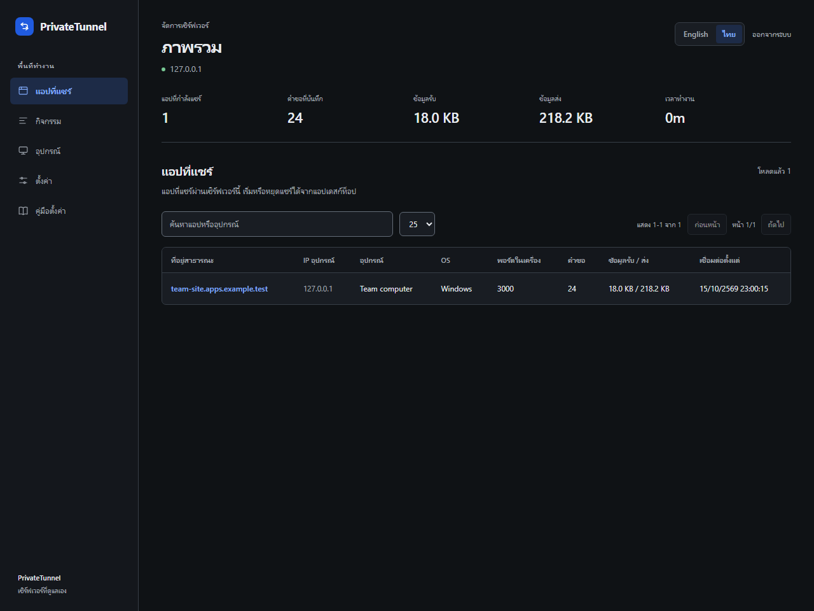

# Getting started

[Overview](../../README.md) · [Thai guide](../th/getting-started.md)

PrivateTunnel has two sides: a public server and a client near the service being shared. If someone already operates the server, ask them for the hostname and an individual access key. You do not need to install a second server on your laptop.

## Choose an installation

| Need | Installation |
| --- | --- |
| Windows desktop | Download the unsigned desktop ZIP from [Releases](https://github.com/Jindanet/private-tunnel/releases), extract it, open the app |
| Linux/macOS desktop | Install Node.js 22.12+ and Git, clone, run `npm ci`, then `npm run app` |
| Terminal on Windows/Linux/macOS | Native CLI download, or Node.js plus the standalone `ptunnel.js` |
| Android/Termux | The one-line command below; no npm |
| ESP32/ESP8266 | Arduino library and setup example; [device guide](devices.md) |
| Public server | DNS, HTTPS and persistent storage; [server guide](server.md) |

Native CLI files are provided for Windows x64, Linux x64, macOS x64 and macOS arm64. On Linux/macOS, mark the downloaded binary executable with `chmod +x <filename>`, then run it from a terminal. Other Node-supported architectures can use `node ptunnel.js`; a matching prebuilt binary is not promised. GUI downloads are currently Windows-only. Downloaded binaries are not signed or notarized and do not update automatically. `SHA256SUMS.txt` detects accidental changes, not publisher authenticity.

## Desktop workflow

Enter `admin.example.com` or the complete WebSocket URL supplied by the administrator. A hostname uses WSS and the default control path automatically. Save the key after a successful connection check. If the administrator uses a custom path, paste their complete URL.

Open the local service first. For a website at `http://localhost:3000`, enter the URL or port `3000`. The GUI shares services on the local computer; use the CLI for a LAN host. Choose HTTP for websites and TCP for SSH, games or another raw TCP protocol. Minecraft Java has a preset; Minecraft Bedrock's UDP protocol is not supported.

The connected card shows the current public address. Copy it or open an HTTP URL to verify access. Stop sharing when finished. Saved entries, a successful earlier check and boot configuration do not prove current external reachability. Test from another network when checking DNS and firewalls.



This retained administrator capture uses Thai and predates the device-key selector. It shows the existing dashboard layout; the new selector is described in the device guide.

## Termux

First install:

```bash
pkg update -y && pkg install nodejs-lts git -y && git clone --depth 1 https://github.com/Jindanet/private-tunnel.git "$HOME/private-tunnel" && cd "$HOME/private-tunnel" && node ptunnel.js
```

Use the private `$HOME` folder, not shared Android storage. The standalone file includes its WebSocket dependency. The wizard saves `~/.ptunnel` with private permissions and resumes the last tunnel next time. Its key is plaintext in that private file. Android may stop background processes; allow the required background/battery permissions. Reconnection only works while the process exists. [Termux project guidance](https://github.com/termux/termux-app/wiki/RUN_COMMAND-Intent).

## Updates

For a Git checkout, preserve your edits and run `git pull --ff-only`. For a native download, replace it with the new platform file. For a desktop ZIP, close the app before replacing the extracted files. Back up server state before upgrading a server. Reinstall boot jobs after changing their runtime or saved connection settings because each job keeps its own snapshot.

The source version and the published release can differ during development. Read `node ptunnel.js --version` and compare it with the release tag when diagnosing an older binary. Pushing a commit with an already published version does not produce a new release automatically.
