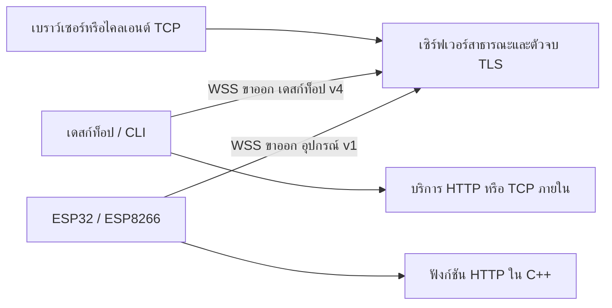

# โครงสร้าง ความปลอดภัย และข้อจำกัด

[ภาพรวม](../../README.th.md) · [เอกสารภาษาอังกฤษ](../en/architecture.md)

ผมเลือกเซิร์ฟเวอร์ที่ดูแลเอง เพื่อให้ผู้ติดตั้งควบคุม DNS กุญแจ และข้อมูลที่บันทึกได้ เซิร์ฟเวอร์จึงเป็นขอบเขตความเชื่อถือที่ชัดเจนด้วย ผู้ดูแลอ่านข้อมูลที่ส่งผ่านได้ และรับผิดชอบกติกาเข้าถึง การอัปเดต และกำลังรองรับงาน

## โปรโตคอลสองแบบสำหรับเครื่องต่างขนาด

เดสก์ท็อป v4 รับหลายงาน HTTP/TCP ใช้สิทธิ์รับต่อ stream **128 KiB** ต่อการเชื่อมต่อ **1 MiB** และ frame สูงสุด **32 KiB** คิดต้นทุน metadata ด้วยเพื่อจำกัด overhead ของ frame เล็ก คิวส่งมีขีดจำกัดทั้งไบต์และจำนวนชิ้น และหยุดแหล่งข้อมูลเมื่อปลายทางช้า มี heartbeat ทุก 30 วินาทีกับตัวตรวจการเชื่อมต่อค้าง ข้อมูล HTTP ที่คืบหน้าต่ออายุการจับเวลาหยุดนิ่ง จึงไม่ตัดคำตอบที่ยังเดินเพียงเพราะครบ 30 วินาที

อุปกรณ์ v1 รับ **HTTP หนึ่งงาน** ใช้ frame และหน้าต่าง 512 ไบต์ กับ body ทั้งหมด 1 KiB ตัวแปลงที่สร้างฝั่งเซิร์ฟเวอร์ใช้ระบบเจ้าของชื่อ การจองชื่อ บันทึก และเก็บกวาดเดิม ไม่ใช่ flag ใน JSON ที่ผู้เชื่อมต่ออ้างเอง และไม่เปิดทางให้เดสก์ท็อปข้าม `REQUIRE_DATA_TRANSPORT_V4` buffer C++ คงที่ แต่ Wi-Fi, TLS และค่าตั้งต้นยังมีต้นทุนเพิ่ม [รายละเอียดโปรโตคอล](devices.md)

ผมเลือกเรียกฟังก์ชันแทนต่อกลับไปเว็บเซิร์ฟเวอร์อีกตัวบนบอร์ด เพื่อลด socket กับ buffer ซ้ำ ข้อแลกเปลี่ยนคือ API เล็ก ยังไม่มีการส่ง header ตามใจ TCP บนบอร์ด UDP หรือ WebSocket upgrade ของแอป การเชื่อมต่อใหม่ไม่ทำงาน TCP หรือ HTTP ที่ขาดต่อจากจุดเดิม

## แยกการยืนยันตัวตน

- **แอดมิน:** รหัสผ่านหนึ่งชุดกับเซสชัน มีการป้องกันคำสั่งเปลี่ยนข้อมูลและแฮชรหัส ยังไม่มี MFA หรือสิทธิ์หลายระดับ
- **การเชื่อมต่อไคลเอนต์:** กุญแจสุ่มแยกรายการ ส่งใน Authorization เก็บเฉพาะแฮช ตัวตนโปรไฟล์ผูกกับเจ้าของกุญแจ จึงคัดลอก client ID เพื่อแย่งชื่อของอีกกุญแจไม่ได้
- **ผู้ชมของเดสก์ท็อป/CLI:** เปิดทั่วไปเป็นค่าเริ่มต้น แอปต้องมีล็อกอินและสิทธิ์เอง TCP จำกัด IP/CIDR ของผู้เชื่อมต่อจริงได้
- **ผู้ชมของอุปกรณ์:** รหัสสุ่มอีกชุด ตรวจที่เซิร์ฟเวอร์ก่อนส่งเข้าเฟิร์มแวร์ Basic ใช้ชื่อผู้ใช้ `device` สคริปต์ใช้ Bearer ได้ ฟังก์ชันบนบอร์ดยังต้องตรวจคำสั่งและข้อมูลที่รับ

กุญแจแยกมีเพดานสิบหกการเชื่อมต่อ มียอดรวมไคลเอนต์และจำกัดความถี่การ upgrade เบื้องต้น ไม่ใช่ระบบโควตาหรือรับมือการใช้งานผิดประเภทสำหรับบริการสาธารณะครบชุด เปลี่ยนหรือเพิกถอนกุญแจในหน้าตั้งค่าเพื่อตัดเซสชัน การเปลี่ยนกุญแจอุปกรณ์เปลี่ยนทั้งรหัสเชื่อมต่อและผู้ชม

## เข้ารหัสและเก็บรหัส

การเชื่อมต่อระยะไกลต้อง WSS ตัว proxy ของเซิร์ฟเวอร์จบ HTTPS/WSS จึงอ่านข้อมูลในขอบเขตนั้นได้ TCP ดิบไม่ได้ถูกเพิ่ม TLS ของแอปให้เอง ใช้ SSH, TLS หรือโปรโตคอลที่เหมาะเมื่อจำเป็น เก็บ listener ภายในเป็นส่วนตัวและแยกชื่อแอดมินกับเผยแพร่ให้ถูกต้อง

เดสก์ท็อปเก็บ `~/.ptunnel-desktop.json` โดยป้องกันกุญแจผ่าน Electron safeStorage และที่เก็บรหัสของระบบ Linux ต้องมี Secret Service/KWallet จริง ไม่ยอมใช้ `basic_text` หากเปิดกุญแจเก่าไม่ได้ ให้เชื่อมที่เก็บรหัสหรือกรอกใหม่ ไม่มีการเปลี่ยนไปเก็บข้อความโดยเงียบ ส่วน `~/.ptunnel` ของ CLI สำเนางานเริ่มอัตโนมัติ และ EEPROM ของตัวอย่างบอร์ดเป็นข้อความภายใต้การป้องกันท้องถิ่นของแต่ละแบบ ผู้ได้ไฟล์หรืออ่าน flash อาจได้รหัสไป

## บันทึกและข้อมูลส่วนตัว

บันทึกคำขอมี metadata เช่น method, path, สถานะ, IP และ user agent ไม่เก็บ header เต็มหรือ body ตัด query กับ fragment และล้างแถวเก่าเป็นระยะหลังเจ็ดวัน path ยังอาจมีข้อมูลส่วนตัว `REQUEST_LOGGING=false` หยุดเฉพาะข้อมูลใหม่ ฐานข้อมูลเดิม สำรอง ภาพหน้าจอ และบันทึก proxy ต้องจัดแยก Nginx ไม่ได้เปลี่ยนตามค่านี้

## ข้อจำกัดการใช้งานระบบ

เป็นระบบเซิร์ฟเวอร์เดียว ยังไม่ประสานหลายโหนด ไม่มี HA อัปเดตอัตโนมัติ ไฟล์ลงลายเซ็น บันทึกการเปลี่ยนค่าแอดมินแบบถาวร ตัวส่งออก Prometheus ขอบเขตกุญแจรายโดเมน หรือวันหมดอายุกุญแจ mirror ไม่มี transaction ร่วมข้ามฐานข้อมูล และปิดเป้าหมายที่ไม่ใช่หลักใน production

ก่อนเปิดให้หลายคนใช้เป็นบริการสาธารณะ ต้องประเมินกำลังรองรับ การยืนยันตัวตน การรับมือใช้งานผิดประเภท การเฝ้าระวัง และสิทธิ์ดูแลแยก ความเสถียรฮาร์ดแวร์และ RAM สูงสุดของ TLS ยังไม่ผ่านการรับรอง แจ้งช่องโหว่ตาม[นโยบายรายงาน](../../SECURITY.md) ข้อจำกัดที่อธิบายไม่ได้ตัดสิทธิ์การรายงานช่องโหว่จริง
