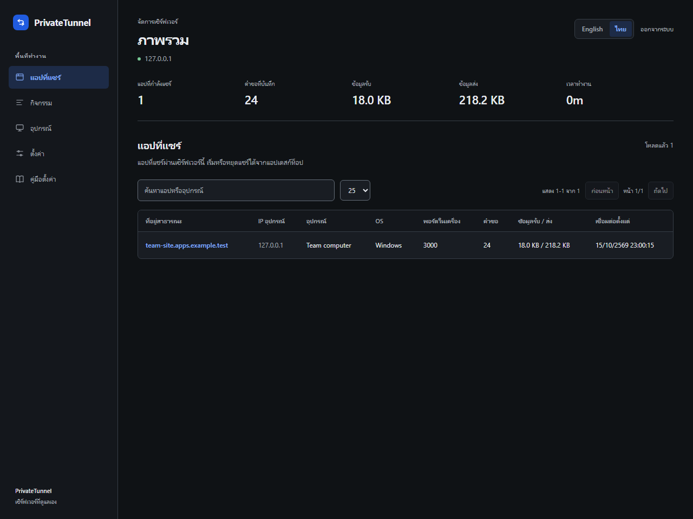

# เริ่มใช้งาน

[ภาพรวม](../../README.th.md) · [เอกสารภาษาอังกฤษ](../en/getting-started.md)

PrivateTunnel มีเซิร์ฟเวอร์สาธารณะกับไคลเอนต์ที่อยู่ใกล้บริการที่ต้องการแชร์ หากมีผู้ดูแลเซิร์ฟเวอร์ให้อยู่แล้ว ให้ขอชื่อเซิร์ฟเวอร์และกุญแจแยกของคุณ ไม่ต้องลงเซิร์ฟเวอร์อีกชุดบนแล็ปท็อป

## เลือกวิธีติดตั้ง

| ต้องการใช้ | วิธีติดตั้ง |
| --- | --- |
| แอป Windows | ดาวน์โหลด ZIP ที่ยังไม่ลงลายเซ็นจาก[หน้าดาวน์โหลด](https://github.com/Jindanet/private-tunnel/releases) แตกไฟล์แล้วเปิดแอป |
| แอป Linux/macOS | ติดตั้ง Node.js 22.12 ขึ้นไปกับ Git โคลนซอร์ส ใช้ `npm ci` แล้ว `npm run app` |
| เทอร์มินัล Windows/Linux/macOS | ไฟล์ CLI สำเร็จรูป หรือ Node.js กับไฟล์ `ptunnel.js` |
| Android/Termux | คำสั่งบรรทัดเดียวด้านล่าง ไม่ต้องใช้ npm |
| ESP32/ESP8266 | ไลบรารี Arduino กับตัวอย่างตั้งค่า ดู[คู่มือบอร์ด](devices.md) |
| เซิร์ฟเวอร์สาธารณะ | DNS, HTTPS และที่เก็บข้อมูลถาวร ดู[คู่มือเซิร์ฟเวอร์](server.md) |

มี CLI สำหรับ Windows x64, Linux x64, macOS x64 และ macOS arm64 บน Linux/macOS ให้ใช้ `chmod +x <ชื่อไฟล์>` ก่อนรันผ่านเทอร์มินัล สถาปัตยกรรมอื่นที่ Node รองรับใช้ `node ptunnel.js` ได้ แต่ไม่ได้มีไฟล์สำเร็จรูปให้ทุกรุ่น แอปแบบดาวน์โหลดมีเฉพาะ Windows ตอนนี้ ไฟล์ยังไม่ลงลายเซ็นหรือผ่าน notarization และไม่มีอัปเดตอัตโนมัติ `SHA256SUMS.txt` ช่วยตรวจไฟล์เปลี่ยนโดยไม่ตั้งใจ แต่ไม่ได้ยืนยันตัวผู้เผยแพร่

## ใช้แอป

กรอก `admin.example.com` หรือ URL ของ WebSocket แบบเต็มจากผู้ดูแล หากใช้เพียงชื่อ ระบบเติม WSS และ path เริ่มต้นให้ บันทึกกุญแจหลังตรวจการเชื่อมต่อสำเร็จ ถ้าเซิร์ฟเวอร์เปลี่ยน path ให้ใช้ URL เต็ม

เปิดบริการในเครื่องก่อน เช่น เว็บ `http://localhost:3000` ให้กรอก URL หรือพอร์ต `3000` แอปแชร์บริการบนคอมเครื่องเดียวกัน หากใช้ IP ใน LAN ให้ใช้ CLI เลือก HTTP สำหรับเว็บ TCP สำหรับ SSH เกม หรือโปรโตคอล TCP มีตัวเลือก Minecraft Java ให้ ส่วน Minecraft Bedrock ที่ใช้ UDP ยังไม่รองรับ

รายการที่เชื่อมต่อแสดงที่อยู่สาธารณะล่าสุด คัดลอกหรือเปิด HTTP URL เพื่อตรวจสอบ กดหยุดเมื่อเสร็จ รายการที่บันทึกไว้ ผลตรวจในอดีต และการตั้งเริ่มอัตโนมัติไม่ได้ยืนยันว่าคนนอกเข้าถึงได้ในตอนนี้ หากตรวจ DNS หรือไฟร์วอลล์ให้ลองจากอีกเครือข่าย



ภาพแอดมินนี้บันทึกไว้ก่อนเพิ่มตัวเลือกกุญแจอุปกรณ์ ใช้แสดงรูปแบบหน้าจอเดิม ส่วนการตั้งค่าอุปกรณ์อธิบายในคู่มือบอร์ด

## Termux

ติดตั้งครั้งแรก:

```bash
pkg update -y && pkg install nodejs-lts git -y && git clone --depth 1 https://github.com/Jindanet/private-tunnel.git "$HOME/private-tunnel" && cd "$HOME/private-tunnel" && node ptunnel.js
```

เก็บไว้ใน `$HOME` ส่วนตัว ไม่ใช้พื้นที่แชร์ของ Android ไฟล์เดียวรวมส่วน WebSocket แล้ว ตัวช่วยตั้งค่าบันทึก `~/.ptunnel` ด้วยสิทธิ์ส่วนตัว และเปิดรายการล่าสุดในครั้งถัดไป กุญแจในไฟล์นี้เป็นข้อความธรรมดา Android อาจหยุดโปรเซสเบื้องหลัง ต้องอนุญาตการทำงานและการใช้แบตเตอรี่ตามต้องการ การเชื่อมต่อใหม่ทำได้เมื่อโปรเซสยังทำงานอยู่เท่านั้น [คำแนะนำจากโครงการ Termux](https://github.com/termux/termux-app/wiki/RUN_COMMAND-Intent)

## อัปเดต

หากโคลนด้วย Git ให้รักษาสิ่งที่แก้เองแล้วใช้ `git pull --ff-only` หากใช้ CLI สำเร็จรูปให้แทนด้วยไฟล์รุ่นใหม่ที่ตรงระบบ แอปแบบ ZIP ให้ปิดแอปก่อนแทนไฟล์ สำรองข้อมูลก่อนอัปเดตเซิร์ฟเวอร์ ติดตั้งงานเริ่มอัตโนมัติใหม่เมื่อเปลี่ยน runtime หรือค่าการเชื่อมต่อ เพราะแต่ละงานเก็บสำเนาค่าของตัวเอง

รุ่นในซอร์สกับรุ่นที่เผยแพร่อาจไม่ตรงกันระหว่างพัฒนา ดู `node ptunnel.js --version` เทียบกับแท็กที่ดาวน์โหลดเมื่อสงสัยว่าเป็นไฟล์เก่า การ push โดยยังใช้เลขรุ่นที่เคยเผยแพร่แล้วจะไม่สร้างชุดดาวน์โหลดใหม่อัตโนมัติ
